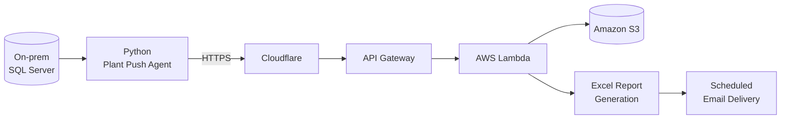

# Hi, I'm Dharanish 👋

### AI & Data Science Engineer · Python · SQL · AWS

*I build data and AI systems that turn operational data into reliable, explainable insights.*

---

## 👨‍💻 About Me

I'm an **AI & Data Science engineer (B.E., 2026)** who likes building practical, end-to-end systems, from the database all the way to the report in someone's inbox. My work spans SQL-driven ETL pipelines, serverless cloud automation, computer-vision applications, live analytics dashboards, and NLP / Generative AI.

| | |
|---|---|
| 🔭 **Currently building** | Cloud data pipelines and automation on AWS |
| 🌱 **Currently growing toward** | Production ML systems for forecasting and classification |
| 🎯 **What I care about** | Reliable, explainable outputs that help teams make decisions |
| 💡 **Strengths** | Python, SQL, ETL design, serverless workflows, reliability & observability |
| 📫 **Open to** | Data Science, ML Engineering, and Data Engineering roles |

---

## 🛠️ Skills & Technologies

| Area | Tools & Topics |
|---|---|
| **Languages** |   |
| **Data & ML** |     |
| **Cloud** |      |
| **Databases** |  |
| **Focus areas** | ETL pipelines · Serverless automation · Computer vision · Live dashboards · Reporting automation |

---

## 🚀 Featured Project

### OCS: Cloud-Based Manufacturing Automation

**Stack:** Python · SQL Server · AWS Lambda · API Gateway · Amazon S3 · Cloudflare

A serverless data platform that replaces manual plant reporting by securely moving production data from on-premises SQL Server databases into AWS, then turning it into ready-to-use reports.

**The problem:** Plant teams relied on manual steps to compile and share production reports, which was slow and error-prone.

**The solution:**

- 🔌 **Plant Push Agent (Python):** extracts production data from on-prem SQL Server and pushes it to cloud endpoints via API Gateway and Amazon S3.
- 📑 **Automated reporting:** generates Excel reports and delivers them by scheduled email, so teams get operational reports with no manual effort.
- 🛡️ **Reliability built in:** logging, retry mechanisms, and scheduled execution for dependable batch jobs and easier debugging.

**Architecture**

> The diagram shows the high-level data flow. Adjust the Cloudflare placement if your setup differs.

**Repository:** `ADD_OCS_REPOSITORY_URL_HERE`

---

## 📜 Certification

- 🏅 **Oracle Certified Professional: Generative AI**

---

## 📊 GitHub Stats

> Stats cards come from a third-party service and may occasionally be unavailable or rate-limited. Language percentages reflect repository contents, not overall skill level.

---

## 🤝 Let's Connect

I'm happy to talk about data pipelines, applied ML, or opportunities.

- 💼 **LinkedIn:** [kv-dharanish](https://www.linkedin.com/in/kv-dharanish/)
- 🐙 **GitHub:** [DHARANISH89](https://github.com/DHARANISH89)

---

*Building reliable data systems today, growing toward production-ready ML tomorrow.*

