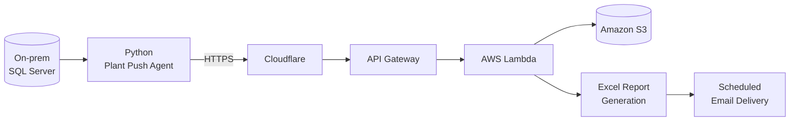

## 👨‍💻 About Me

I'm an **AI & Data Science engineer (B.E., 2026)** who likes building practical, end-to-end systems, from the database all the way to the report in someone's inbox. My work spans SQL-driven ETL pipelines, serverless cloud automation, computer-vision applications, live analytics dashboards, and NLP / Generative AI.

| | |
|---|---|
| 🔭 **Currently building** | Cloud data pipelines and automation on AWS |
| 🌱 **Growing toward** | Production ML systems for forecasting and classification |
| 🎯 **What I care about** | Reliable, explainable outputs that help teams make decisions |
| 📫 **Open to** | Data Science, ML Engineering, and Data Engineering roles |

## 🛠️ Tech Stack

## 🚀 Featured Project

### OCS: Cloud-Based Manufacturing Automation

**Stack:** Python · SQL Server · AWS Lambda · API Gateway · Amazon S3 · Cloudflare

A serverless data platform that replaces manual plant reporting by securely moving production data from on-premises SQL Server databases into AWS, then turning it into ready-to-use reports.

- 🔌 **Plant Push Agent (Python):** extracts production data and sends it to cloud endpoints through API Gateway and Amazon S3.
- 📑 **Automated reporting:** generates Excel reports and delivers them by scheduled email, with no manual effort for plant teams.
- 🛡️ **Reliability built in:** logging, retry mechanisms, and scheduled execution for dependable batch jobs.

**Repository:** `ADD_OCS_REPOSITORY_URL_HERE`

## 📂 More From My Repos

| Project | What it does | Language |
|---|---|---|
| [**ZeroMind**](https://github.com/DHARANISH89/ZeroMind) | Submit sensitive health, financial, or hiring data to an AI model without exposing raw inputs, and get back a verifiable on-chain credential |  |
| [**Co-Chess**](https://github.com/DHARANISH89/Co-Chess) | Chess project |  |
| [**AI-Wound-Analysis**](https://github.com/DHARANISH89/AI-Wound-Analysis) | AI-based wound analysis |  |
| [**Yoga-pose-prediction**](https://github.com/DHARANISH89/Yoga-pose-prediction) | Yoga pose classification |  |
| [**House-price-prediction**](https://github.com/DHARANISH89/House-price-prediction) | Housing price model using Support Vector Regression with feature engineering and hyperparameter tuning |  |
| [**Customer-segmentation**](https://github.com/DHARANISH89/Customer-segmentation) | K-Means customer segmentation with EDA and Elbow / Silhouette cluster selection |  |

## 📜 Certification

- 🏅 **Oracle Certified Professional: Generative AI**

## 📊 GitHub Stats

> Stats cards come from third-party services and may occasionally be unavailable or rate-limited. Language percentages reflect repository contents, not overall skill level.

## 🤝 Let's Connect

- 💼 **LinkedIn:** [kv-dharanish](https://www.linkedin.com/in/kv-dharanish/)
- 🐙 **GitHub:** [DHARANISH89](https://github.com/DHARANISH89)

*Building reliable data systems today, growing toward production-ready ML tomorrow.*

